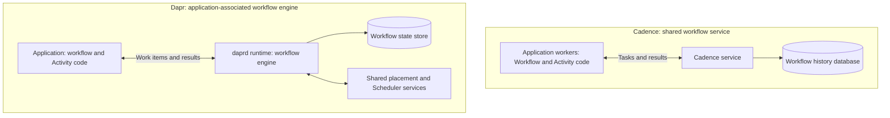

Cadence and Dapr Workflow both run durable, code-defined workflows. Both record execution history and use deterministic replay to recover after failures. The main distinction is how orchestration is deployed and operated: Cadence provides a dedicated workflow service, while Dapr embeds a workflow engine in its application runtime, usually deployed as a sidecar.

:::note Scope and versions

Documentation reviewed on **November 19, 2026**. Release references are [Cadence Server v1.4.5](https://github.com/cadence-workflow/cadence/releases/tag/v1.4.5) and [Dapr v1.19.2](https://github.com/dapr/dapr/releases/tag/v1.19.2). SDKs, Cadence Web, Dapr Agents, and independently supplied dashboards have separate release cycles. Linked documentation can describe newer or preview capabilities; verify each required feature against the exact versions and configuration you plan to deploy.

This comparison is based on documentation and selected source checks. It is not a performance benchmark or an end-to-end compatibility test. “Supported” does not imply identical APIs, guarantees, defaults, or feature parity across SDKs.

:::

## Feature Comparison

### Similar/Common in Both

| Feature | Cadence | Dapr Workflow |
| ----- | ----- | ----- |
| **Code-defined workflows** | Workflow code runs in application-owned workers. | Workflow code runs in application processes connected to the Dapr runtime. |
| **Durable execution and replay** | Persists workflow events and reconstructs execution through deterministic replay. | Persists workflow events and reconstructs execution through deterministic replay. |
| **Long-running workflows** | Durable waits, timers, and event handling. | Durable waits, timers, and event handling. |
| **External operations** | Activities execute model calls, service calls, database operations, and other side effects. | Activities execute model calls, service calls, database operations, and other side effects. |
| **Retries** | Configurable Activity and Workflow retry policies. | Configurable durable Activity and child-workflow retry policies. Policy semantics differ. |
| **Parallel and child workflows** | Activities and child workflows can execute concurrently. | Activities and child workflows can execute concurrently. |
| **Human interaction** | Signals deliver decisions; workflow code can wait durably. | External events deliver decisions; workflow code can wait durably. |
| **Bounded history growth** | Continue-as-new and child workflows support long-lived processes. | Continue-as-new and child workflows support long-lived processes. |
| **Workflow evolution** | SDK versioning APIs support replay-compatible changes. | Patching and named workflow versioning support replay-compatible changes; SDK support varies. |
| **AI/agent orchestration** | Models and tools execute through Activities and SDK integrations. | Models and tools execute through Activities; the separate Dapr Agents framework provides additional agent abstractions. |
| **Deployment choice** | Self-hosted; Kubernetes is optional. | Self-hosted; Kubernetes is optional. |
| **Open source** | Apache-2.0, CNCF project. | Apache-2.0, CNCF project. |

See the [Cadence workflow model](https://cadenceworkflow.io/docs/concepts/workflows/) and [Dapr Workflow overview](https://docs.dapr.io/developing-applications/building-blocks/workflow/workflow-overview/). Dapr documents the distinction between [durable workflow retry policies and Dapr resiliency policies](https://docs.dapr.io/developing-applications/building-blocks/workflow/workflow-features-concepts/#retry-policies).

### Where Dapr Can Be a Better Fit

| Requirement | Cadence | Dapr Workflow |
| ----- | ----- | ----- |
| **An existing Dapr platform** | Introduces a dedicated workflow service and its operational requirements. | Reuses the Dapr deployment model and integrations already operated by the organization. |
| **A broader distributed-application API** | Focuses on durable execution; applications integrate messaging, secrets, and other services as needed. | Offers service invocation, pub/sub, state, bindings, secrets, and other building blocks alongside workflows. |
| **Workflow SDK language choice** | Project-maintained SDKs include Go, Java, and Python. | Documents Go, Java, JavaScript, .NET, and Python workflow SDKs. Individual features are not available equally across them. |
| **Persistence-provider choice** | First-class persistence support includes Cassandra, MySQL, and PostgreSQL. | Supports multiple actor-compatible state stores, including PostgreSQL, MySQL, Redis, and SQLite. Workflow support requires more than a generic Dapr state-store integration. |
| **An application-oriented runtime model** | Applications deploy workers that connect to a separately operated Cadence service. | Applications connect to a nearby Dapr runtime that handles workflow execution infrastructure and other application APIs. |

These advantages are strongest when Dapr is already part of the environment. A new Dapr deployment still requires operating its runtime, supporting services, and persistent storage. See [Dapr building blocks](https://docs.dapr.io/concepts/building-blocks-concept/), [supported workflow SDKs](https://docs.dapr.io/developing-applications/building-blocks/workflow/workflow-overview/#supported-sdks), and [workflow state-store requirements](https://docs.dapr.io/developing-applications/building-blocks/workflow/workflow-architecture/#state-store-usage).

### Where Cadence Can Be a Better Fit

| Requirement | Cadence | Dapr Workflow |
| ----- | ----- | ----- |
| **A shared workflow platform** | A dedicated, multitenant service accepts requests and retains queued work independently of application worker availability. | Workflow engines normally run in application-associated Dapr runtimes. Application/runtime availability and routing are part of operating the workflow API. |
| **Explicit worker-pool routing** | Named task lists route work to independent worker pools, with durable buffering and server-side dispatch throttling. | Routes work among application replicas and can target other application IDs. This provides a different mechanism for separating and scaling work. |
| **Workflow-specific operator interfaces** | Cadence Web is an open-source UI usable with local and production clusters, including history, Queries, management actions, and Custom Workflow Controls. | The open-source Dapr Dev Dashboard provides local workflow inspection and cleanup. Diagrid's separate platform console provides execution graphs and broader workflow actions. Deployment scope and product restrictions differ; see [Web UI and Workflow Operations](#web-ui-and-workflow-operations). |
| **Indexed business-state search** | Advanced visibility provides SQL-like filtering over registered search attributes, with a configured indexing backend. | Documents workflow listing and filtering by metadata. An equivalent indexed business-state search capability is not established by the workflow management sources reviewed here. |
| **Workflow-level overload protection** | Documents domain limits, task-list throttling, and Workflow ID-based limits on external requests and internal work. | Documents per-sidecar and global workflow/Activity concurrency limits, including limits by workflow or Activity name. These are different controls; concurrency limits are not requests-per-second quotas. |
| **Cross-cluster workflow recovery** | Global Domains provide workflow-history replication and controlled failover between Cadence clusters. | The reviewed workflow documentation does not establish an equivalent Global Domain facility. Assess recovery of the complete Dapr deployment, including its state store and Scheduler data. |

Cadence references: [deployment topology](https://cadenceworkflow.io/docs/concepts/topology/), [task lists](https://cadenceworkflow.io/docs/concepts/task-lists/), [Custom Workflow Controls](https://cadenceworkflow.io/docs/concepts/workflow-queries-formatted-data/), [advanced visibility](https://cadenceworkflow.io/docs/concepts/search-workflows/), [Workflow ID-based rate limits](https://cadenceworkflow.io/blog/2024/09/05/workflow-specific-rate-limits/), and [cross-datacenter replication](https://cadenceworkflow.io/docs/concepts/cross-dc-replication/).

Dapr references: [workflow management](https://docs.dapr.io/developing-applications/building-blocks/workflow/howto-manage-workflow/), [multi-application workflows](https://docs.dapr.io/developing-applications/building-blocks/workflow/workflow-multi-app/), and [workflow concurrency limits](https://docs.dapr.io/developing-applications/building-blocks/workflow/workflow-concurrency/). “Not established” identifies a limit of this review, rather than proving that a capability cannot be supplied by an application, integration, or commercial offering.

### No Comparable Benchmark Data Established Here

| Question | What a fair comparison requires |
| ----- | ----- |
| **Which has higher throughput?** | The same workflow shape, payloads, persistence durability, hardware budget, and failure conditions. |
| **Which has lower latency?** | Comparable histories, concurrency, network placement, storage, and retry settings, with tail latency included. |
| **Which costs less?** | The complete runtime, storage, observability, availability, staffing, and support costs for the target workload. |
| **Which provides stronger tenant isolation?** | Explicit tenant boundaries and measured interference under the intended resource and quota configuration. |
| **Which recovers faster or loses less progress?** | Equivalent failure scenarios, replication settings, storage guarantees, and measured recovery objectives. |

This page makes no numerical performance, cost-saving, replication-latency, or maximum-scale claim. Results from one project's production deployment or one provider's price comparison do not establish an equivalent result for the other project.

## Background and Architecture

### Where Is the Dapr Workflow Server?

Dapr has a workflow engine. It is embedded in `daprd`, the Dapr runtime, typically deployed beside an application as a sidecar process or container. The application's Workflow SDK receives work from that runtime, executes the workflow or Activity code, and returns results. The engine uses internal actors and a configured state store to persist workflow progress. Shared Dapr services provide placement and durable scheduling.

Cadence deploys its engine as a separate service. Application-owned workers poll task lists for workflow and Activity tasks. The service records history, manages timers, and retains work while those workers are unavailable.

This diagram shows the usual deployment shapes, not every supported topology. Dapr also documents shared-runtime deployments. Both systems execute application workflow code outside the engine process shown here; both require persistent infrastructure for durability. Dapr's Scheduler has its own persistent data, separate from the workflow state store.

See [Dapr workflow architecture](https://docs.dapr.io/developing-applications/building-blocks/workflow/workflow-architecture/) and [Scheduler architecture](https://docs.dapr.io/concepts/dapr-services/scheduler/).

### Actors, Replicas, and Design Lineage

An actor is a logical entity with an identity and state. An application replica is another running copy of an application. Many actors can be hosted across a smaller number of replicas. Dapr uses actors internally for workflows; application authors can use the Workflow SDK without implementing their own actor model.

Dapr's actor model uses the virtual-actor pattern associated with Orleans and Service Fabric Reliable Actors. Its workflow engine, [`durabletask-go`](https://github.com/dapr/durabletask-go), documents a separate implementation lineage: it began as a Go port of the .NET Durable Task Framework and also draws on Go Workflows. A Dapr workflow recovers through persisted history and replay, rather than restoring a snapshot of an application process's memory.

### Work Across Applications and Worker Pools

Dapr supports activities and child workflows hosted by other application IDs. Its documentation specifies same-namespace and shared workflow/actor state-store requirements, and SDK support varies. Within an application ID, replicas must register the same set of workflows and Activities, with a compatible versioning strategy. Splitting work into different application IDs provides an independent deployment and scaling boundary.

Cadence routes workflow and Activity tasks through task lists, allowing separate worker pools for different implementations, resource requirements, and deployment schedules. Workers serving the same task list must be compatible with the tasks routed to it. Task-list separation does not replace authorization or tenant isolation.

Both can distribute an AI application's orchestration, model calls, and tools across services. Compare the routing and operational model rather than treating cross-application execution as exclusive to either project.

## Web UI and Workflow Operations

Both ecosystems provide workflow screens. The useful comparison is which tool supplies them, where it can run, and which operations it supports.

| Tool | Documented capabilities | Deployment and caveats |
| ----- | ----- | ----- |
| **[Cadence Web](https://github.com/cadence-workflow/cadence-web)** | Workflow listing and filtering, execution history, Queries, management actions, and Custom Workflow Controls. | Open-source, self-hostable UI for local and production Cadence clusters. Individual features depend on server/Web versions, feature flags, and permissions. Advanced search requires the corresponding visibility infrastructure. |
| **[Dapr Dev Dashboard](https://github.com/diagridio/dev-dashboard)** | Workflow lists and search, live event history, inputs, outputs, custom status, logs, and individual or bulk terminate/purge actions. | Free and Apache-2.0 licensed. Its documentation explicitly limits its intended use to local development, excluding production, staging, shared/hosted environments, and Kubernetes deployments. |
| **[Diagrid Web Console](https://docs.diagrid.io/operate/project-operations/workflows/)** | Workflow execution graphs, history, error details, filtering, external events, suspend/resume, rerun from an event, and bulk actions. | Part of the separately provided Diagrid platform. Evaluate product terms, deployment requirements, and integration restrictions independently of the open-source Dapr runtime. |
| **[Dapr Ops Dashboard](https://docs.diagrid.io/dapr-open-source/dapr-ops-dashboard/)** | Dapr installation/upgrades, certificate management, Kubernetes application topology, runtime health, metrics, and operational diagnostics. | Diagrid SaaS product, formerly Conductor. Its infrastructure-management focus is distinct from the individual workflow-execution interface described above. |
| **[Original Dapr Dashboard](https://github.com/dapr/dashboard)** | Application, component, configuration, actor, and runtime information. | Archived. Its README directs users to the Dapr Dev Dashboard; do not treat it as the current maintained workflow UI. |

Cadence Web's workflow-specific integration is particularly useful for human interaction: an application-defined read-only Query can return formatted Markdown containing business state and buttons that send Signals or start workflows. An approval prompt can therefore be presented within the workflow's page. Query handlers require an available compatible worker, and actions remain subject to configuration and authorization.

Diagrid's workflow console can raise external events, so an operator can also deliver a decision to a waiting Dapr workflow. The distinction is the supplied user experience and deployment model: a workflow-provided approval screen and a generic external-event action are different interfaces. Dapr applications and integrations can provide additional business-specific screens.

:::note Console and agent-workflow restrictions

The reviewed Diagrid console documentation disables workflow management actions when the application's workflow worker is disconnected. It also lists durable-agent workflows as an exception for which management actions are disabled. Verify the exact product, workflow type, and integration before promising approval or recovery controls for an agent sample. These are restrictions of the documented console/product combination, not a statement that Dapr lacks external-event APIs.

:::

The options above establish that Dapr has comparable workflow-inspection and management interfaces. They do not establish feature parity with Cadence Web or an exhaustive list of third-party dashboards. Compare the required production workflow UI directly, including deployment, permissions, supported actions, and commercial terms where applicable.

## Reliability and Feature Caveats

- **Durable execution does not make external side effects exactly once.** If an external operation succeeds but its completion is not recorded, a retry can repeat it. Use idempotency keys, deduplication, or an appropriate transactional integration for payments, bookings, writes, and other consequential operations.
- **A recorded completion is different from an operation that merely returned.** Replay reuses completed Activity results already present in durable history. Failures around recording that completion can still cause repeated work, including repeated model calls.
- **Workflow code must remain deterministic.** Put model calls, network access, filesystem operations, and other nondeterministic work in Activities. Use each SDK's durable time and concurrency APIs. Deploy replay-compatible changes using the relevant [Cadence versioning](https://cadenceworkflow.io/docs/go-client/workflow-versioning/) or [Dapr versioning](https://docs.dapr.io/developing-applications/building-blocks/workflow/workflow-versioning/) mechanisms.
- **History and payloads have practical limits.** Long-running does not mean unbounded history or payload size. Storage transaction limits, individual record limits, history growth, and replay cost matter. Design appropriate continue-as-new and child-workflow boundaries.
- **Multi-region is not a default guarantee.** A Cadence Global Domain has one active cluster at a time. Asynchronous replication can leave lag and cause lost progress or repeated work during failover. Database replication alone does not establish recovery of a complete Dapr workflow deployment.
- **SDK and framework support require separate checks.** A runtime feature, an SDK API, and an agent-framework integration are different compatibility claims. Dapr Agents is separately versioned from Dapr Workflow. A project's overall maturity does not establish feature parity across these layers.
- **More than one retry layer can increase attempts.** An Activity's durable retry policy can coexist with retries in an HTTP client, model client, or Dapr resiliency policy. Evaluate the combined attempt count, time budget, and downstream limits.

## Open Source, Governance, and Portability

Both projects are open source under Apache-2.0 and are hosted by CNCF. As of this review, [Cadence is a Sandbox project](https://www.cncf.io/projects/cadence-workflow/) and [Dapr is a Graduated project](https://www.cncf.io/projects/dapr/). CNCF maturity describes project-level criteria; it is not a benchmark of a specific workload, SDK, or workflow feature.

Both can be self-hosted. Adopting either still creates a dependency on its workflow APIs, operational model, and history format. Moving between them requires application changes and a plan for in-flight workflows; changing a storage component does not make their histories interchangeable. Cloud-provider portability and workflow-engine portability are separate concerns.

## Managed Solutions & Pricing

The open-source licenses of Cadence and Dapr do not impose a per-workflow-action fee. Infrastructure, operations, and optional commercial products or support still have costs. Managed-service pricing is provider-specific and should not be attributed to an open-source engine as a universal pricing model.

For Cadence, include the shared service, persistence, optional advanced visibility infrastructure, application workers, and operating costs. For Dapr, include application runtimes or sidecars, control-plane services, workflow state storage, Scheduler persistence, observability, and operating costs. Existing platform infrastructure can change the incremental cost substantially.

Include any separately provided production workflow console in that cost and support assessment. The free Dapr Dev Dashboard's local-development scope does not establish the terms or capabilities of a production dashboard.

Compare current quotes and measured infrastructure usage at the same availability and recovery targets. This review does not establish a general managed-price advantage for either project.

## Choosing Between Them

Consider **Cadence** when the main requirement is a dedicated durable-execution platform shared by independent services, with explicit worker queues, workflow-focused operations, and configured cross-cluster recovery.

Consider **Dapr Workflow** when the main requirement is durable orchestration within a Dapr-based application platform, particularly when its other building blocks and supported SDKs already match the organization's architecture.

Validate the decision with the same representative workflow: run the required SDKs, interrupt a worker during an external operation, restart during a human-approval wait, exercise downstream throttling, and inspect the evidence operators would use to diagnose failures. A successful restart demonstrates a capability both projects provide; deployment fit, required semantics, and operating experience should determine the choice.

*This is a living comparison. Propose corrections with versioned documentation, source references, or reproducible evidence in the [Cadence-Docs repository](https://github.com/cadence-workflow/Cadence-Docs).*
